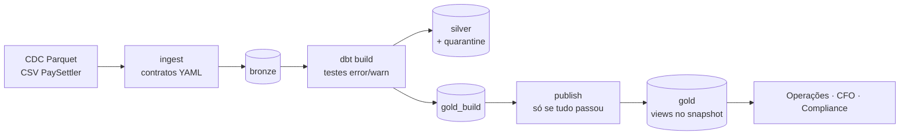

# Case Técnico — Engenheiro(a) de Dados Sênior / Especialista

> **Solução.** Pipeline medallion em DuckDB + DuckLake + dbt, com contratos de dados, quarentena, publicação write-audit-publish e observabilidade por execução. As respostas às seções da entrega estão no fim deste README, em [Entrega](#entrega). Leituras de apoio:
>
> - [`docs/data-products.md`](docs/data-products.md): Parte 1, perguntas por consumidor e queries de exemplo
> - [`docs/architecture.md`](docs/architecture.md): Parte 3.1 e 3.2, produção e troubleshooting
> - [`docs/scale.md`](docs/scale.md): Parte 3.3, números medidos com 5M de transações
> - [`docs/decisions.md`](docs/decisions.md): cada decisão e o motivo
>
> Para rodar: `docker compose up -d --build` e `docker compose exec pipeline pipeline run --reference-date 2025-03-16`.

## Contexto de Negócio

Você está entrando no time de dados de uma fintech que processa liquidações de pagamentos para merchants. A empresa opera o **Settlement Reconciliation Service** — um serviço em produção que:

1. Recebe diariamente um **arquivo CSV** do processador de pagamentos externo (**PaySettler**) com as transações liquidadas nas últimas 24h
2. Compara essas transações com os **registros internos** do sistema
3. Categoriza cada transação e persiste os resultados em um **PostgreSQL** (`settlement_db`)

O serviço funciona bem, mas **todos os dados vivem apenas no banco transacional**. O time de operações precisa saber se a taxa de discrepância está subindo. O CFO quer o volume transacionado por dia. Compliance precisa de histórico de auditoria. **Ninguém tem acesso estruturado a nada disso hoje.**

### Sua Missão

Construir uma solução que transforme esses dados em **produtos de dados** consumíveis pelo negócio. Cabe a você decidir como.

---

## Domínio: Reconciliação de Liquidações

> O glossário completo está em [`docs/domain-glossary.md`](docs/domain-glossary.md). Leia antes de começar.

### Tabelas Fonte (`settlement_db`)

**`transactions`** — Transações internas do sistema

| Coluna | Tipo | Descrição |
|--------|------|-----------|
| `id` | bigint | PK |
| `transaction_id` | uuid | Identificador único da transação |
| `merchant_id` | varchar | Identificador do merchant |
| `amount` | decimal | Valor da transação (BRL) |
| `currency` | varchar | Moeda (ISO 4217) |
| `status` | varchar | `COMPLETED`, `PENDING`, `FAILED` |
| `description` | varchar | Descrição da transação |
| `created_at` | timestamp | Data de criação |
| `updated_at` | timestamp | Última atualização |

**`reconciliation_runs`** — Execuções de reconciliação

| Coluna | Tipo | Descrição |
|--------|------|-----------|
| `id` | bigint | PK |
| `reference_date` | date | Data de referência do arquivo (dia de negócio) |
| `file_name` | varchar | Nome do arquivo processado |
| `status` | varchar | `IN_PROGRESS`, `COMPLETED`, `FAILED` |
| `total_transactions` | integer | Total de transações no arquivo |
| `started_at` | timestamp | Início do processamento |
| `completed_at` | timestamp | Fim do processamento |
| `created_at` | timestamp | Data de criação do registro |

**`reconciliation_results`** — Resultados da reconciliação

| Coluna | Tipo | Descrição |
|--------|------|-----------|
| `id` | bigint | PK |
| `run_id` | bigint | FK → `reconciliation_runs.id` |
| `transaction_id` | uuid | Identificador da transação |
| `merchant_id` | varchar | Identificador do merchant |
| `category` | varchar | `MATCHED`, `MISMATCHED`, `UNRECONCILED_PROCESSOR`, `UNRECONCILED_INTERNAL` |
| `internal_amount` | decimal | Valor no sistema interno (null se unreconciled_processor) |
| `processor_amount` | decimal | Valor no PaySettler (null se unreconciled_internal) |
| `difference` | decimal | Diferença absoluta entre valores |
| `created_at` | timestamp | Data de criação |

**`enterprise_company`** — Dados cadastrais dos merchants

| Coluna | Tipo | Descrição |
|--------|------|-----------|
| `id` | bigint | PK |
| `merchant_id` | varchar | Código do merchant |
| `legal_name` | varchar | Razão social |
| `trade_name` | varchar | Nome fantasia |
| `document` | varchar | CNPJ |
| `primary_cnae` | varchar | CNAE principal |
| `created_at` | timestamp | Data de criação |
| `updated_at` | timestamp | Última atualização |

### Arquivo CSV do PaySettler

O processador externo envia diariamente um CSV com as transações liquidadas.

| Coluna | Tipo | Descrição |
|--------|------|-----------|
| `transaction_id` | uuid | Identificador da transação |
| `merchant_id` | varchar | Identificador do merchant |
| `amount` | decimal | Valor liquidado |
| `currency` | varchar | Moeda (ISO 4217) |
| `settled_at` | datetime (ISO 8601, UTC) | Data/hora da liquidação |
| `processor_reference` | varchar | Referência interna do processador |
| `status` | varchar | `SETTLED` ou `REVERSED` |

---

## Stack

- **Linguagem:** Python 3.12+
- **Processamento:** DuckDB
- **Conteinerização:** Docker + Docker Compose
- **Armazenamento:** Filesystem local

A solução deve **rodar localmente** com `docker-compose up`.

---

## Dados de Exemplo

Na pasta `docs/sample-data/` você encontrará:

- `transactions_batch_1.parquet` — Transações internas (lote 1)
- `transactions_batch_2.parquet` — Transações internas (lote 2)
- `reconciliation_runs.parquet` — Execuções de reconciliação
- `reconciliation_results.parquet` — Resultados categorizados
- `settlement_paysettler.csv` — Arquivo CSV do PaySettler
- `enterprise_company.parquet` — Dados cadastrais de merchants

---

## Como Começar

1. **Faça um fork** deste repositório para sua conta pessoal do GitHub
2. Clone o seu fork e trabalhe nele normalmente
3. Suba o ambiente:

```bash
docker compose up -d --build
# ou: make up
```

Um `Makefile` no repositório expõe atalhos para as operações mais comuns (`make help` lista os alvos disponíveis). O uso é opcional.

---

## Requisitos

### Parte 1 — Modelagem e Analytics

Usando os dados disponíveis, **modele e implemente tabelas analíticas** que atendam os seguintes consumidores:

- **Operações:** precisa acompanhar a saúde das reconciliações no dia a dia
- **CFO:** precisa de visão consolidada do volume financeiro
- **Compliance:** precisa de rastreabilidade e histórico para auditorias

**A forma e o conteúdo das tabelas são decisão sua.** Traduza as dores acima em métricas e tabelas analíticas (fatos e dimensões) que você defenderia em produção. Documente, para cada consumidor:

- **Quais perguntas** seu modelo consegue responder (e quais deliberadamente não)
- **Por que** essas e não outras (priorização, tradeoffs de escopo vs tempo)

Entregue também exemplos de queries rodando contra suas tabelas que respondem as perguntas que você propôs. Queremos ver seu raciocínio de produto, não só SQL.

---

### Parte 2 — Pipeline de Dados

Implemente o pipeline que processa as fontes de dados disponíveis e prepara o insumo para as tabelas analíticas da Parte 1.

O volume em `docs/sample-data/` é pequeno de propósito — assuma **~5M transações/mês em produção** e projete para crescer. Se quiser validar na prática como seu pipeline se comporta em escala, use o gerador descrito na seção _"Dados de Exemplo e Geração de Volume"_.

Critérios de qualidade (como você os atende é decisão sua — documente suas escolhas):

- **Correção:** a saída do pipeline bate com o contrato de dados que você propôs
- **Idempotência:** executar o pipeline para a mesma data de referência duas vezes não pode duplicar registros nem corromper as tabelas. Considere como isso se manifesta na sua CLI, nas tabelas finais e em falhas no meio da execução
- **Observabilidade:** em produção, quando algo quebrar, que sinais você precisaria para diagnosticar rapidamente?
- **Qualidade de dados:** quais checks você adicionaria para proteger os consumidores de downstream de dados incorretos? O que faria o pipeline parar versus apenas alertar?
- **Testabilidade:** como você valida automaticamente que uma mudança no código não quebra o comportamento?

Stack obrigatória: **DuckDB** para processamento, **Python 3.12+**, **Docker Compose** para subir o ambiente.

---

### Parte 3 — Arquitetura

#### 3.1 Desenho de Arquitetura

**Explique e/ou desenhe** como você levaria esses dados do banco transacional até o consumo pelo negócio em produção.

#### 3.2 Troubleshooting

Segunda-feira de manhã. Ops abre um chamado: os dashboards de reconciliação estão sem dados desde sexta-feira à noite. Você é o primeiro a chegar.

Como você investigaria? Que artefatos do próprio pipeline você consultaria? Até onde iria antes de acionar mais alguém?

#### 3.3 Escalabilidade

Hoje o volume é pequeno, mas o negócio projeta chegar em **~5M transações/dia** em 18 meses (≈1,8B/ano em `reconciliation_results`). Como você prepararia a plataforma para esse crescimento? Onde o desenho atual quebra primeiro?

---

## Dados de Exemplo e Geração de Volume

O repositório oferece duas fontes de dado. **A escolha de volume e de quais fontes usar é sua.**

### 1. Fixture pequeno — `docs/sample-data/`

Cerca de 1.000 transações internas e ~500 liquidações. Pensado para exploração, desenvolvimento local e como insumo default dos exemplos de queries da Parte 1.

### 2. Gerador sintético — `scripts/generate_sample_data.py`

Produz o mesmo schema do fixture (CDC `Op`/`_timestamp`, schema drift entre batches, padrões realistas de dados sujos) em volume arbitrário. Útil para validar seu pipeline em escala — por exemplo, ao redor dos ~5M transações/mês assumidos na Parte 2.

**Você define o volume e as características.** O script é parametrizável:

```bash
# dataset médio para smoke em escala (1M transações, 90 dias)
python scripts/generate_sample_data.py --rows 1000000 --days 90 --out /tmp/medium

# dataset alinhado à projeção de ~5M transações/mês
python scripts/generate_sample_data.py --rows 5000000 --days 30 --out /tmp/month
```

Flags principais:

| Flag | Descrição | Default |
|------|-----------|---------|
| `--rows N` | Total de transações internas a gerar | `1000000` |
| `--days N` | Janela temporal em dias | `90` |
| `--merchants N` | Número de merchants | `500` |
| `--seed N` | Semente determinística | `42` |
| `--out PATH` | Diretório de saída | `docs/sample-data` |

Rode `python scripts/generate_sample_data.py --help` para a lista completa. Dentro do container, `make generate` (10k linhas) e `make generate-large` (1M linhas) são atalhos prontos.

---

## Uso de IA

Fique à vontade para usar ferramentas de IA durante o desafio. Se usar, documente no item _"Ferramentas de IA utilizadas"_ da entrega quais ferramentas e para quê. Se mantiver prompts, configs (`CLAUDE.md`, `.cursorrules`, etc.) ou transcrições no repositório, melhor — ajuda a entender seu processo.

---

## Entrega

1. Ao finalizar, **abra um Pull Request do seu fork para o repositório original** (branch `main`)
2. Preencha as seções abaixo no README do seu PR:

### Como rodar

Só precisa de Docker. A internet é usada apenas no build da imagem.

```bash
docker compose up -d --build

# pipeline completo sobre o fixture: ingestão, dbt e publicação da gold
# (o CSV do fixture não tem data no nome, então a data vai no comando)
docker compose exec pipeline pipeline run --reference-date 2025-03-16

# painel de diagnóstico: execuções, frescor por fonte, o que está publicado, alertas
docker compose exec pipeline pipeline status

# queries de exemplo da Parte 1 (todas em docs/queries/)
docker compose exec pipeline pipeline query docs/queries/ops_01_run_health.sql

# testes: 62, cerca de 3 minutos
docker compose exec pipeline pytest
```

Com `make` disponível: `make up`, `make run`, `make status`, `make test`.

Outros caminhos:

- **Dados do gerador.** `docker compose exec pipeline python scripts/generate_sample_data.py --rows 100000 --days 30 --out /tmp/gen` e depois `docker compose exec pipeline pipeline run --data-path /tmp/gen`. Os CSVs do gerador têm a data no nome, então `--reference-date` não é necessário.
- **Reprocessar uma data.** `pipeline transform --reference-date 2025-03-16` apaga e regrava só essa data no fato da gold.
- **Explorar no navegador.** No host, fora do container: `pip install "duckdb>=1.5.6,<1.6"` e `python scripts/explore.py`. Abre o lake na DuckDB UI, em modo leitura. Feche com Enter antes de rodar o pipeline de novo, porque o catálogo aceita um escritor por vez.
- **Benchmark.** `docker compose exec pipeline python scripts/benchmark.py --rows 5000000 --days 30`, cerca de 8 minutos.

Códigos de saída da CLI: `0` ok (pode haver alertas), `1` dado bloqueado (arquivo fora do contrato ou check de qualidade), `2` erro técnico. Um orquestrador repete o `2` e não repete o `1`.

### Premissas e decisões

O registro completo, com o motivo de cada escolha, está em [`docs/decisions.md`](docs/decisions.md). As que mais mudam o resultado:

**Não refaço a reconciliação.** `reconciliation_results` é a fonte de verdade das categorias. O CSV de exemplo não reproduz os resultados (488 de 510 linhas têm valor diferente do interno), então recalcular daria números que não batem com o que o serviço gravou. O CSV entra como dado bruto do processador.

**Os dados de exemplo são inconsistentes entre si, e tratei cada fonte pelo que ela é.** No fixture, resultados e transações divergem em 95% dos merchants e dos valores. Nos dados do gerador, a divergência é zero. Por isso não preencho campo de uma fonte com dado da outra; por exemplo, os 16 `merchant_id` nulos nos resultados continuam nulos e geram alerta.

**CDC: ordem por `_timestamp` e, no empate, D > U > I.** A transação `acc62b77` tem U e D no mesmo instante; ordenando só pelo tempo, ela continuava ativa por acaso.

**Dinheiro sempre em `decimal(18,2)`.** Em `double`, 127 resultados `MATCHED` pareciam passar da tolerância de R$ 0,01. Em decimal, sobram 5, todos de um `run_id` (99) que não existe na tabela de runs.

**Datas em UTC.** Um `settled_at` sem fuso é tratado como UTC, como o glossário define. O fixture tem 25 casos.

**Nada é descartado em silêncio.** Registro com problema vai para `silver.quarantine`, com o motivo e a linha original. Se mais de 5% de uma fonte cair lá, o pipeline não publica.

**Moedas não se somam.** O README diz que tudo é BRL, mas o gerador produz USD e EUR. Sem taxa de câmbio, cada moeda é uma linha. Os resultados de reconciliação não trazem moeda e são tratados como BRL.

**A mesma transação aparece em vários runs.** As janelas de 7 dias se sobrepõem (no fixture, um run a cada 3 dias), então separei o que cada run disse do que continua aberto agora.

**Ambiguidades que resolvi por conta própria e que validaria com o time.** No fixture, os runs são a cada 3 dias, mas o glossário fala em arquivo diário. Há resultados regravados dentro do mesmo run (44 linhas); guardo todos e uso o mais recente. Há também três limiares que escolhi sem histórico para calibrar: 5% de quarentena para bloquear, +2 pontos percentuais para marcar pico de discrepância e 4 GB de memória para o DuckDB.

### Visão geral da arquitetura



Medallion sobre DuckLake, numa pasta local: o catálogo é um arquivo DuckDB, e os dados são Parquet. Cada camada tem uma responsabilidade:

- **Bronze.** Cópia fiel das fontes, só append, com hash do arquivo e linha de origem. Idempotente por hash de arquivo e, no CDC, por hash de evento.
- **Silver.** CDC resolvido (estado atual e histórico SCD2), tipos, normalização e quarentena.
- **Gold.** Seis tabelas desenhadas a partir das perguntas de cada consumidor ([`docs/data-products.md`](docs/data-products.md)). O dbt grava e testa tudo em `gold_build`. Só se o build inteiro passar, as views de `gold` passam a apontar para o snapshot testado, numa transação (write-audit-publish). Se um check bloqueante falha, os consumidores continuam vendo a última versão boa.

Cada execução fica registrada em `ops.pipeline_runs`, com o resultado de cada teste em `ops.dq_results` e cada publicação em `ops.publications`.

```
contracts/          contrato YAML de cada fonte
src/settlement_pipeline/
  cli.py            pipeline ingest | transform | run | query | status
  pipeline.py       orquestra uma execução e registra em ops.pipeline_runs
  bronze.py         ingestão idempotente e validação de contrato
  transform.py      roda o dbt em subprocesso e lê o resultado de cada teste
  publish.py        publica a gold (views fixadas no snapshot)
dbt/models/silver/  CDC, tipos, quarentena, settlements (formato comum dos processadores)
dbt/models/gold/    produtos de dados por consumidor
docs/queries/       queries de exemplo da Parte 1, testadas automaticamente
docs/               decisões, produtos de dados, arquitetura (Parte 3) e escala
scripts/            gerador (original), benchmark e explore (DuckDB UI)
tests/              62 testes: bronze, silver, gold, pipeline, extensibilidade
```

A Parte 3 está em [`docs/architecture.md`](docs/architecture.md) (desenho de produção e troubleshooting) e [`docs/scale.md`](docs/scale.md) (números medidos com 5M de transações e onde o desenho quebra).

### Extensibilidade

Um segundo processador não exige mudança em Python, na gold ou nos testes existentes. O caminho é o mesmo que `tests/test_extensibility.py` executa com um processador fictício (o "FastPay": colunas em português, valor em centavos, data no formato brasileiro e status com outros nomes):

| Arquivo | Mudança |
|---|---|
| `contracts/fastpay_settlements.yml` | novo, cerca de 15 linhas: colunas, onde o arquivo chega e como extrair a data do nome |
| `dbt/models/silver/fastpay_settlements_checked.sql` | novo, cerca de 25 linhas: traduz para o formato comum e declara os checks |
| `dbt/models/silver/fastpay_settlements.sql` | novo, 3 linhas: as linhas aceitas |
| `dbt/models/sources.yml` | +1 linha: a tabela do bronze |
| `dbt/dbt_project.yml` | +1 item na lista `settlement_processors` |
| `dbt/models/silver/_silver.yml` | opcional, cerca de 10 linhas: limite de quarentena e unicidade do processador novo |

São 3 arquivos novos e 2 linhas em arquivos existentes. A ingestão é guiada pelo contrato, então o bronze ganha a tabela sozinho. A quarentena itera sobre a lista de processadores, e a gold lê `silver.settlements`, que já junta todos com uma coluna `processor`. O volume do CFO e a trilha de auditoria passam a incluir o processador novo sem mudança.

Testes: a suíte inteira roda de novo (`pytest`). O que garante o caminho é `test_extensibility.py`, que faz exatamente essas mudanças numa cópia do projeto e verifica que o processador aparece da silver até a gold. Para um processador real, eu copiaria esse teste com uma amostra do arquivo dele.

O que daria mais trabalho: um processador que não entrega arquivo (API ou JSON aninhado) precisa de um leitor novo em `bronze._reader_sql`. Um processador que usa outro identificador de transação precisaria de uma tabela de correspondência antes de qualquer cruzamento.

### Limites do desenho

**1. Um escritor por vez no catálogo.** O catálogo do DuckLake é um arquivo DuckDB local. Duas execuções simultâneas não funcionam, e um leitor com conexão aberta (um DBeaver esquecido) já impede o pipeline de escrever. Isso aconteceu várias vezes durante o desenvolvimento; hoje o erro pelo menos diz o que fazer. Produção precisa do catálogo em Postgres, que o DuckLake suporta.

**2. O custo de uma execução cresce com o histórico, não com o dia.** A silver é reconstruída inteira a cada execução, e a deduplicação de CDC compara cada evento novo com todos os anteriores. Com 5M de transações isso leva cerca de 90 segundos ([`docs/scale.md`](docs/scale.md)), mas com 5M por dia e um ano de histórico passaria de horas. Precisaria de silver incremental, com marca d'água por lote, e idempotência pela posição no log do CDC (LSN/offset) em vez de hash.

**3. Um reenvio do processador substitui o dia inteiro.** Se o PaySettler reenvia o arquivo de uma data, a versão mais recente vale por completo. Se ele mandar um arquivo só com as linhas corrigidas, o resto do dia some da silver (continua no bronze). Um processador que manda correções parciais precisaria de uma regra de merge por transação, combinada com ele.

### O que faria diferente em produção

O que simplifiquei: pasta local em vez de object storage, extrações CDC em arquivo em vez de Debezium e Kafka, a CLI no lugar de um orquestrador, tabelas `ops` no lugar de alertas de verdade, limiares escolhidos sem histórico e nenhum controle de acesso.

O que a versão de produção precisaria, em ordem (detalhes em [`docs/architecture.md`](docs/architecture.md)):

1. Catálogo em Postgres e dados em object storage.
2. Orquestrador (eu escolheria Dagster pela integração com dbt e o modelo de assets) disparando pela chegada do arquivo, com backfill por intervalo de datas e retry só em erro técnico.
3. Alertas a partir das tabelas `ops`. O primeiro seria de frescor: gold sem publicação nova até as 06h. No cenário do troubleshooting, o problema deveria ter sido descoberto na sexta à noite pelo alerta, não na segunda pelo usuário.
4. Silver incremental e idempotência por posição do CDC, antes de o volume chegar a 5M por dia.
5. Retenção de snapshots alinhada com Compliance (testei: o lake do benchmark foi de 11,5 GB para 4,8 GB sem quebrar a gold publicada) e compactação de arquivos.
6. Contratos de dados como acordo formal com os times donos das fontes, revisados junto.
7. Limiares calibrados com histórico real, acesso por schema (consumidores só em `gold`) e o benchmark rodando no CI.

### Ferramentas de IA utilizadas

Usei o **Claude Code** (modelo Claude Opus) como par de programação durante o case inteiro, no terminal e com acesso ao repositório e ao Docker. O [`CLAUDE.md`](CLAUDE.md) na raiz é o arquivo que ele lê no início de cada sessão: tem as decisões já tomadas, as regras de engenharia, o que já sabíamos dos dados e o que ele não pode decidir sozinho. Fui atualizando esse arquivo ao longo do trabalho, e ele mostra bem como o processo foi conduzido.

**Para que usei:**

- explorar os dados de exemplo com DuckDB antes de desenhar qualquer coisa;
- implementar a partir de um desenho que eu aprovava antes (bronze, silver, gold, observabilidade);
- escrever os testes e rodar tudo dentro do container;
- medir em escala;
- fazer o primeiro rascunho da documentação, que eu revisei.

**Decisões que eu tomei ou direcionei:**

- a premissa de uma solução nível staff com arquitetura medallion;
- questionar se Airflow fazia sentido na entrega (a conclusão foi que não);
- a regra de desempate do CDC (timestamp e depois D > U > I);
- a aprovação do desenho da gold antes de codar;
- exigir documentação em linguagem natural;
- marcar como provisórias as decisões com limiar arbitrário, para revisar no fim.

**Onde a IA errou e o processo pegou o erro.** Acho que isto diz mais sobre o uso de IA do que a lista acima:

- O primeiro teste de atomicidade do DuckLake "falhou" por um erro no próprio script de teste (consulta preguiçosa no Python), não no DuckLake. O erro foi encontrado antes de virar uma conclusão errada.
- A primeira versão do bloqueio de qualidade não protegia a gold de verdade (o dbt substitui a tabela antes de testá-la). Isso foi encontrado no planejamento da observabilidade e resolvido com write-audit-publish, agora coberto por teste.
- O `.gitignore` original ignorava qualquer pasta `silver/` ou `gold/`. O primeiro commit teria ido sem nenhum modelo dbt.
- Um número na documentação estava errado (20 merchants em vez de 12). Pedi para conferir cada número contra os dados.
- Dois bugs só apareceram com volume real: a configuração de memória do DuckDB e a resolução de CDC rodando duas vezes. Os testes com o fixture não pegariam nenhum dos dois.

Em todos esses casos, o que segurou o erro foi a combinação de testes automatizados, rodar de verdade em vez de supor e revisar o resultado antes de aceitar.

---

## Prazo

Você tem **3 a 4 dias** para completar o desafio.

Valorizamos uma solução **completa, limpa e bem documentada** mais do que rica em features. Se o tempo estiver curto, reduza escopo, não qualidade.

---

## Observações

- **Não inclua código malicioso no projeto.** Caso identificado, o projeto será desconsiderado.
- Após a entrega, faremos uma **conversa técnica de ~45 minutos** sobre sua implementação e decisões.

*Boa sorte! Qualquer dúvida sobre o enunciado, entre em contato antes de assumir premissas.*
