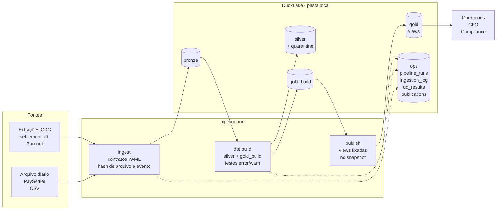

# Arquitetura

Este documento cobre a Parte 3 do case: como eu levaria isso para produção (3.1), como investigaria o cenário de segunda-feira (3.2) e onde o desenho quebra com o crescimento (3.3, em [`scale.md`](scale.md)).

## O que existe hoje



Uma execução é um comando (`pipeline run --reference-date AAAA-MM-DD`) e passa por quatro etapas:

1. **Ingestão.** Valida cada arquivo contra o contrato da fonte e copia para o bronze sem transformar nada. Um arquivo já visto (mesmo hash) é ignorado, e um evento CDC já carregado não entra de novo. Se um arquivo viola o contrato, a execução para aqui.
2. **Transformação.** O dbt monta a silver (CDC resolvido, tipos, quarentena) e a gold num schema de build, testando cada modelo.
3. **Auditoria.** Se algum teste com severidade `error` falha, nada é publicado.
4. **Publicação.** As views de `gold` passam a apontar para o snapshot que acabou de ser testado, numa transação.

Tudo fica registrado em `ops`, e `pipeline status` mostra o resumo.

## 3.1 Em produção

```mermaid
flowchart LR
    pg[(settlement_db<br/>Postgres)] -- replicação lógica --> debezium[Debezium]
    debezium --> kafka[[Kafka]]
    kafka -- sink Parquet --> landing[(Object storage<br/>landing/cdc)]
    paysettler[PaySettler] -- SFTP --> landing_csv[(Object storage<br/>landing/paysettler)]

    landing --> orq{{Orquestrador<br/>Dagster}}
    landing_csv -- evento de chegada --> orq
    orq -- pipeline run --reference-date --> job[Container do pipeline<br/>DuckDB + dbt]

    job <--> lakehouse[(Lakehouse<br/>object storage<br/>catálogo em Postgres)]
    lakehouse --> bi[BI<br/>Metabase / Superset]
    lakehouse --> analistas[SQL ad hoc]

    job -. métricas e logs .-> obs[Observabilidade<br/>Datadog / Grafana]
    obs -. alertas .-> oncall[Slack / PagerDuty]
```

**Captura.** As extrações que recebi já têm cara de Debezium (`Op`, `_timestamp`), então eu manteria isso: replicação lógica do Postgres, Debezium publicando no Kafka e um sink gravando Parquet no object storage. O banco transacional não recebe nenhuma query analítica. O arquivo do PaySettler chega por SFTP num bucket de landing, e a chegada dispara a execução.

**Armazenamento.** O mesmo desenho medallion, num object storage em vez de pasta local. Para o catálogo, as duas opções que eu consideraria:

- **DuckLake com catálogo em Postgres.** É a continuação natural do que está aqui e libera escrita concorrente, que hoje é a principal limitação (o catálogo é um arquivo DuckDB, com um escritor por vez).
- **Iceberg com catálogo REST.** É mais maduro e é o padrão quando o mesmo dado precisa ser lido por Spark, Trino, Snowflake e afins.

Escolheria pelo resto da plataforma. Se a empresa já tem Iceberg, Iceberg. Se não tem nada, DuckLake com Postgres é bem mais simples de operar.

**Processamento.** DuckDB num container por execução, chamado pelo orquestrador. No volume atual e no projetado para 18 meses, uma máquina com DuckDB dá conta. Os números estão em `scale.md`. Spark só entraria se o volume passasse do que uma máquina grande resolve com folga, e isso não deve acontecer neste horizonte.

**Orquestração.** Eu escolheria Dagster: o modelo de assets mapeia um para um as tabelas do medallion, e a integração com dbt é nativa. Airflow também serve, se já for o padrão da casa. O que o orquestrador precisa fazer:

- disparar a execução diária quando o arquivo do PaySettler chega, e alertar se ele não chegar até um horário limite;
- passar a `reference_date`, que é o contrato da CLI;
- tentar de novo erros de infraestrutura (código de saída 2), mas **não** dados bloqueados (código 1), porque repetir não muda o dado;
- fazer backfill por intervalo de datas, que é seguro porque a execução é idempotente.

**Qualidade.** Os mesmos contratos e testes de hoje. Em produção, os contratos virariam acordo formal com os times donos das fontes, versionado e revisado junto, para uma mudança de schema não chegar de surpresa.

**Consumo.** BI lendo `gold`. As views publicadas garantem que um dashboard nunca mostra meia atualização. Num ambiente com várias ferramentas consumindo, eu definiria as métricas num lugar só (camada semântica) para "taxa de discrepância" ter uma única definição.

**Observabilidade.** Hoje as tabelas `ops` são a fonte. Em produção, eu exportaria delas métricas e alertas:

| Sinal | Alerta quando |
|---|---|
| Frescor da publicação | gold sem publicação nova até as 06h |
| Execução terminou | status `failed` ou `blocked` |
| Execução presa | `running` há mais de 2x a duração normal |
| Arquivo do processador | não chegou até o horário combinado |
| Quarentena | acima do normal para a fonte, mesmo abaixo do limite de bloqueio |
| Saúde da reconciliação | `health_status` diferente de `OK` (este alerta vai para Operações, não para o time de dados) |

O último ponto importa: um run `FAILED` no serviço de reconciliação não é problema do pipeline de dados. O pipeline mostra o problema, e quem age é o dono do serviço.

**Governança.**

- Acesso por schema: consumidores leem só `gold`, e `bronze` e `silver` ficam restritos ao time de dados.
- Retenção de snapshots alinhada com Compliance. Hoje eles crescem sem limite, e expirar um snapshot publicado quebraria a view que aponta para ele.
- O CNPJ é dado de empresa, não pessoal. Mesmo assim, eu revisaria com o jurídico antes de abrir para mais gente.

## 3.2 Troubleshooting: dashboards sem dados desde sexta à noite

Segunda de manhã, Operações diz que os dashboards de reconciliação estão sem dados desde sexta à noite. A primeira coisa que eu faria é responder ao chamado dizendo que estou olhando. A segunda é entender se "sem dados" quer dizer vazio ou parado em sexta. Quase sempre é parado, e isso muda a investigação: o pipeline não apagou nada, ele deixou de publicar.

O ponto de partida é um comando:

```bash
pipeline status
```

Ele responde, de uma vez, quatro perguntas, e cada resposta aponta para um caminho diferente.

**Rodou alguma coisa desde sexta?** (bloco "Últimas execuções")

- **Não há execução desde sexta.** O pipeline nem foi chamado. O problema está no agendamento: orquestrador fora, schedule desligado num deploy, credencial expirada. Vou para os logs do orquestrador.
- **Tem execução parada em `running`** (bloco "Execuções que não terminaram"). O processo morreu no meio, por falta de memória ou reinício da máquina. Olho os logs do container. Como a execução é idempotente, depois de entender a causa é só rodar de novo.
- **Execuções com status `failed`.** Erro técnico. A coluna `error` diz qual, e o log completo do dbt fica em `data/dbt_target/logs/`. Filtro os logs JSON pelo `run_id` da execução.
- **Execuções com status `blocked`.** O pipeline rodou e se recusou a publicar. É o comportamento desenhado: os dashboards mostram a última versão boa, que é a de sexta. O bloco "Alertas e falhas" diz qual check barrou, e `silver.quarantine` mostra os registros e os motivos. Nesse caso o problema está na fonte, não no pipeline.

**Os arquivos chegaram?** (bloco "Frescor por fonte")

Se a última carga do PaySettler é de sexta, o arquivo de sábado não chegou ou chegou repetido. Um reenvio do mesmo arquivo aparece como `skipped` em `ops.ingestion_log`, com o motivo "mesmo conteúdo já carregado". Antes de tratar como incidente, verifico se o PaySettler liquida no fim de semana. Pode ser o comportamento normal.

**O que os consumidores estão vendo?** (bloco "O que os consumidores estão vendo")

Se o último run publicado é anterior ao último run que existe na silver, a gold está atrasada em relação aos dados, e a causa está numa execução bloqueada ou que falhou.

**O serviço de reconciliação rodou?**

```bash
pipeline query docs/queries/ops_01_run_health.sql
```

Se o run de sexta aparece como `FAILED` em `agg_run_health`, o pipeline de dados funcionou. Quem falhou foi o serviço de reconciliação, e não existem resultados para mostrar. O fixture tem exatamente esse caso: o run de 22/03 terminou `FAILED`, com 116 resultados declarados e nenhum gravado.

**Até onde eu vou sozinho.** Se a causa está no pipeline (execução que morreu, erro de código, lake travado por alguém com uma conexão aberta), eu resolvo: corrijo, rodo de novo as datas afetadas e confirmo pela publicação que os consumidores voltaram a ver dados novos. Reprocessar é seguro, porque rodar a mesma data duas vezes não duplica nada.

Se a causa está fora do pipeline, eu aciono o dono assim que confirmo isso, sem tentar contornar. Exemplos: o serviço de reconciliação não rodou, o CDC parou, o PaySettler não mandou o arquivo, ou uma fonte mandou dado que o check barrou. Forçar a publicação de um dado que o check barrou é exatamente o que o check existe para evitar.

Nos dois casos, aviso Operações sobre o que está acontecendo e até quando os dados estão confiáveis ("os números estão certos até sexta 23h; o de sábado depende do time X").

Depois, o ponto mais importante: o problema foi descoberto por um usuário na segunda de manhã, e deveria ter sido descoberto pelo alerta de frescor na sexta à noite. Esse alerta (tabela da seção 3.1) é a primeira coisa que entraria no pós-incidente.

**Artefatos que o próprio pipeline deixa:**

| Artefato | Responde |
|---|---|
| `ops.pipeline_runs` | o que rodou, quando, com que status, quanto tempo levou, qual snapshot publicou |
| `ops.ingestion_log` | cada arquivo recebido: hash, linhas, ignorado ou bloqueado, e por quê |
| `ops.dq_results` | resultado de cada teste em cada execução |
| `ops.publications` | o que os consumidores estavam vendo, e desde quando |
| `silver.quarantine` | cada registro barrado, com motivo e linha original |
| `data/dbt_target/` | `run_results.json` e logs completos do dbt da última execução |
| logs JSON | um evento por etapa, filtrável por `run_id` e `batch_id` |
| snapshots do DuckLake | o que mudou em cada escrita (`ducklake_table_changes`) |
